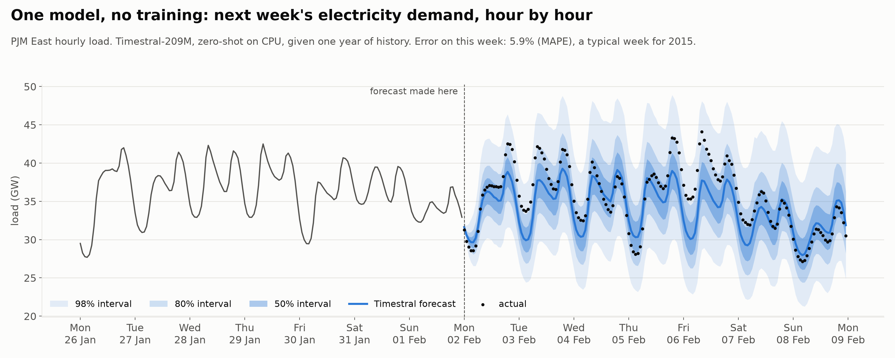
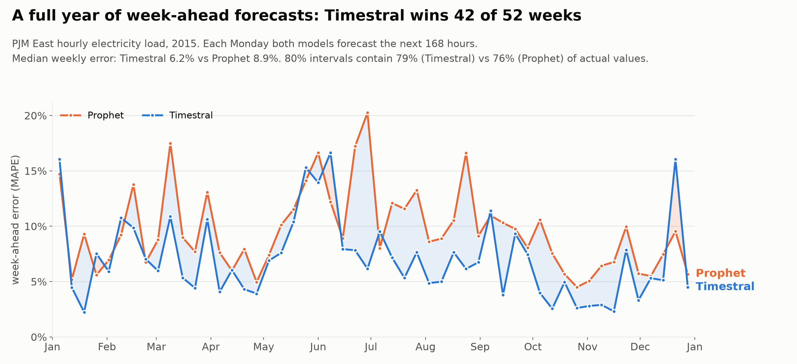
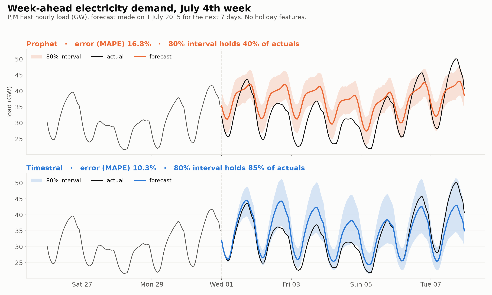
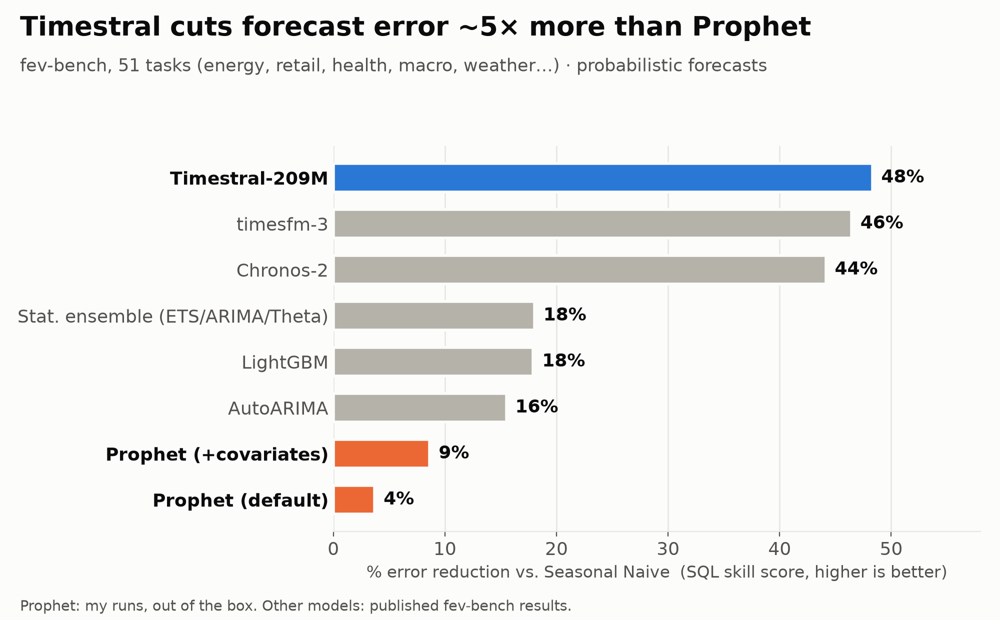
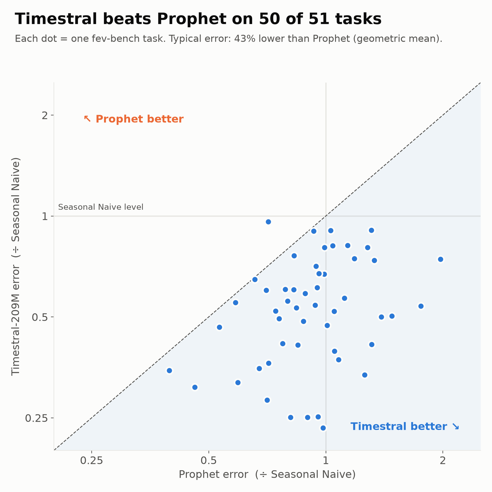
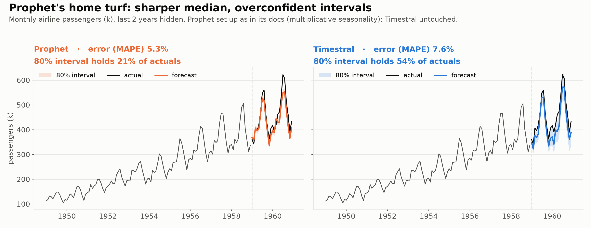

# LinkedIn post: Prophet vs Timestral

## 1. Images to upload (in this order)

LinkedIn shows uploaded images above the text, so attach these with the post.

## 2. Text to paste (everything below the line)

---

Is it time to retire Prophet? 📉

Last week Mistral released Timestral, an open-source time-series foundation model. I tested it against Prophet, the go-to forecasting tool in many data teams, on 51 real-world tasks from the fev-bench benchmark (energy, retail, health, macro, weather).

The results:

🔹 Timestral beats Prophet on 50 of 51 tasks.
🔹 Its typical error is 43% lower than Prophet's.
🔹 It beats the simple "same as last season" baseline on all 51 tasks. Prophet beats it on only 33, even with covariates.
🔹 Prophet also ranks below AutoARIMA, LightGBM and a standard statistical ensemble.

And Timestral needs no training and no tuning. You give it the history and get probabilistic forecasts back.

Two examples:
⚡ Hourly electricity demand (PJM East): every Monday of 2015, both models forecast the next 7 days. Timestral wins 42 of the 52 weeks, with a median weekly error of 6.2% against 8.9% for Prophet. The gap is largest in summer: in the July 4th week, Timestral's error is 10.3% and Prophet's 16.8%.
✈️ Airline passengers, Prophet's own textbook demo, set up as in its docs: Prophet's median forecast is sharper (5.3% vs 7.6%). But its 80% interval contains only 21% of the actual values, against 54% for Timestral. That means its forecast is far less certain than it claims.

Takeaway: if Prophet is still your default, compare it with a foundation model (Timestral, TimesFM, Chronos) before your next forecast. You may get a large accuracy gain for little effort.

How I ran it: I ran Prophet myself out of the box, once as is and once with covariates and non-negative clipping. The figures for the other models are the published fev-bench results, including Mistral's own submission for Timestral. All models are scored with the same metric (SQL, a measure of probabilistic accuracy). I used 51 of the benchmark's 100 tasks, the ones small enough to run Prophet on.

Code and notebook: https://github.com/sduprey/timestral_prophet

#TimeSeries #Forecasting #MachineLearning #FoundationModels #Prophet #MistralAI
